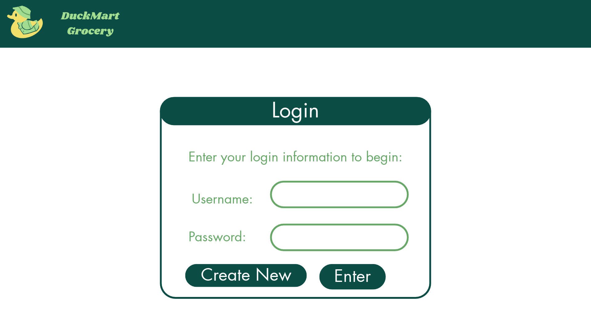

# Website Page Designs
## Login Page
Contains input forms for the username and password so users that already have an account can log in. Users without an account can select the "create new" button to go to the create account page.

## Account Creation Page
Has input forms for name, username, email, address, and password. Once an account has been created, users can return to the login page and log in.

## Home/Search Products
Allows customers to browse DuckMart's available grocery items by category and search for specific products. Each product displays an image, name, price, and can be clicked on to view more details. There are also options to go to my account or contact us.

## Product Details/Reserve Products
Shows a few additional details about the product and includes an "add to cart" button.

## Contact Us
Displays data to contact the store, such as email and phone number.

## My Account
This page will appear mostly the same for all customers, employees, and admin. They can change some of this data. Employees and admin will have a button to go to the employee dashboard.

## Employee Dashboard
The landing page for employees. Appears with a custom greeting for the employee name and a closer look at the cute mascot.

## Manage All Products
This page will have an "add new" button to create a new product.

## Edit/Remove Individual Products
This page will appear the same for creating a new product, but with all fields already empty.

## Manage Users
This page only shows up on the employee dashboard if you are logged in to an account with admin privileges. It shows all users that have accounts and allows you to click on them to edit individual users.

## Edit/Remove Individual Users
This page shows the details for the user's account including username, email, and address. There is an option to give a user employee status, or even admin status. Admin can only access this page. 
